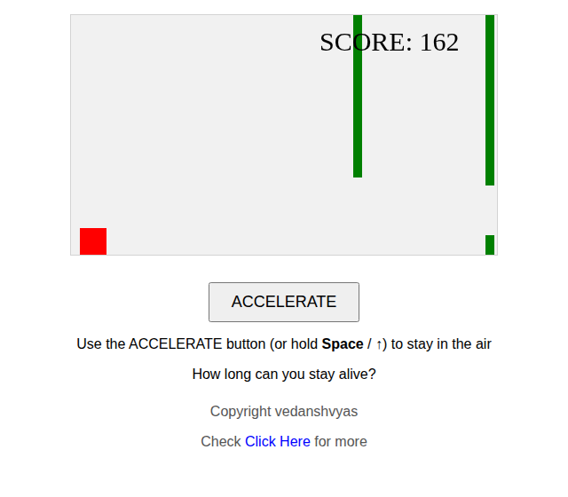

# game1 — Stay in the Air

A tiny Flappy-style browser game in a single HTML file: you are the red
square, gravity pulls you down, and green pillars scroll in from the
right. Hold the button (or a key) to rise, release to fall, and dodge the
pillars for as long as you can. Your score is how many frames you survive.

*Screenshot captured from the actual game running in headless Chromium
(score 162 — the red square is resting at the bottom after falling with
no input). The image is an SVG wrapping that real PNG capture.*

## How to play

- **Hold** `ACCELERATE` (mouse/touch) or hold **Space** / **↑** to rise.
- **Release** to fall back down.
- Dodge the green pillars. Touch one and it's game over — the canvas
  shows your score and a **RESTART** button appears to play again.
- The longer you stay alive, the higher your score.

## How to run

No build step, no dependencies, no server needed — just open the file:

- Double-click `index.html`, or
- Serve it locally, e.g. `python3 -m http.server` and open
  <http://localhost:8000>, or
- Enable **GitHub Pages**: repo Settings → Pages → Source: `main` branch,
  `/ (root)` folder. The game will then be live at
  <https://vedansh2821.github.io/game1/> (Pages is not confirmed enabled
  — enable it as above if the link 404s).

## Tech

- Single self-contained `index.html` — HTML + CSS + vanilla JavaScript,
  no libraries or external assets.
- The game is drawn on a `<canvas>` (480×270) with `setInterval`
  at 20 ms; obstacles spawn every 150 frames with a random height/gap.
- The only external reference is a link to <https://www.ved2821.live>
  in the footer — it loads nothing, so the game works fully offline.

## Files

| File | What it is |
| --- | --- |
| `index.html` | The whole game. |
| `screenshot.svg` | Gameplay screenshot (real capture, PNG embedded in an SVG — the GitHub connector only pushes text files, so the PNG is wrapped this way). |
| `.github/workflows/ci.yml` | CI: checks the HTML parses and that no external scripts/stylesheets are loaded. |

## Notes

- The game was verified by running it in headless Chromium: canvas
  renders, obstacles scroll, the score counts up, and both buttons are
  present — no console errors.
